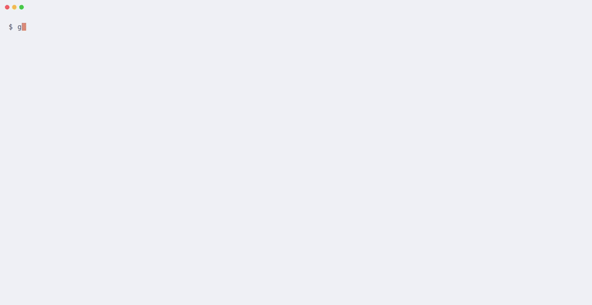

# gl-issues

[](https://github.com/ansgomez/gl-issues/actions/workflows/ci.yml)
[](https://github.com/ansgomez/gl-issues/releases)
[](go.mod)
[](LICENSE)

**Terminal issue dashboard and CLI for GitLab.**

Terminal dashboard for the issues of a GitLab group and its subgroups. It
shows what is open, overdue, due soon or unassigned. From the list you can
comment, assign people, set due dates, edit descriptions, and close or
reopen issues. The same actions also work as plain subcommands for scripts.
gl-issues talks to GitLab through [`glab`](https://gitlab.com/gitlab-org/cli)
(`glab api`), so it uses glab's networking and always glab's login for
the configured host.

<picture>
  <source media="(prefers-color-scheme: dark)" srcset="docs/demo-dark.gif">
  
</picture>

<sub>Recorded against a sample group and issues served by a stand-in for
glab. `make demo` re-records both themes (requires
[VHS](https://github.com/charmbracelet/vhs) and python3).</sub>

## Features

- A tree of the group's subgroups, with tasks and child issues nested
  under their parent, or a flat list; two-line or compact rows.
- Filters (mine, unassigned, due soon), search, and sorting by due date,
  last update or project.
- Comment, assign, set due dates, edit the description in `$EDITOR`, and
  close or reopen, on one issue or on a selection; create new issues.
- A quiet background refresh that tags new and updated issues across
  restarts, and your pending GitLab To-Dos in the title.
- The same actions as subcommands for scripts.
- No token of its own: glab's login does the work, and `gl-issues
  doctor` checks the whole setup.

## Quick start

Replace `gitlab.example.com` with your GitLab host and `acme/platform`
with your group.

1. Install glab and gl-issues (see [Install](#install); on Linux, see
   [gl-issues on Linux](docs/linux.md)). With `make
   install`, gl-issues goes to `$(go env GOPATH)/bin`: add that to your
   `PATH` if it is not there yet.
2. Create a personal access token at
   `https://<host>/-/user_settings/personal_access_tokens` (`api` scope to
   change issues, `read_api` if you only want to look) and log glab in
   with it (see
   [Log in](docs/configuration.md#log-in-and-token-scopes)). glab 1.123 and later keeps the
   token in the OS keyring (`gl-issues doctor` says where yours is);
   gl-issues holds none:

   ```sh
   glab auth login --hostname gitlab.example.com
   glab auth status --hostname gitlab.example.com   # must say "Logged in"
   ```

3. Create the config file and set `host` and `group` (see
   [Configure](#configure)):

   ```sh
   gl-issues init                     # prints the file it created, mode 600
   ${EDITOR:-nano} ~/.config/gl-issues/config.toml   # or $XDG_CONFIG_HOME/gl-issues/
   ```

4. Check the setup (config, glab, login and where glab keeps the token,
   group, token scopes), then list the issues as plain text:

   ```sh
   gl-issues doctor
   gl-issues list
   ```

5. Start the dashboard: `gl-issues`. It opens as a tree with one folded
   label (`▹`) per subgroup: `f` (or `enter`) unfolds the label under
   the cursor, `b` unfolds or folds them all, and `l` cycles the layout
   (two group levels, then a flat list, then one level again). Press `h` for help, `q` to quit.

If a step fails, see [Troubleshooting](docs/troubleshooting.md).

## Install

Linux and macOS (Intel and ARM). gl-issues needs a recent
[`glab`](https://gitlab.com/gitlab-org/cli) at run time (tested with
glab 1.123).

| What | Command |
| --- | --- |
| glab | `brew install glab` (Linux: [docs/linux.md](docs/linux.md)) |
| gl-issues, release download | archive, `.deb` or `.rpm` from the [Releases page](https://github.com/ansgomez/gl-issues/releases) |
| gl-issues, from source (Go 1.26+, `git`, `make`) | `git clone https://github.com/ansgomez/gl-issues.git gl-issues && cd gl-issues && make install` |

[docs/install.md](docs/install.md) has the full steps, including how to
verify a download (checksum, cosign signature, build provenance
attestation).

## Configure

The config file is `~/.config/gl-issues/config.toml`, created by
`gl-issues init`. It holds no token. Set at least:

```toml
host  = "gitlab.example.com"      # bare host name, no https://, no path
group = "acme/platform"
```

All settings, environment variables and flags are in
[docs/configuration.md](docs/configuration.md).

## Documentation

- [Installing gl-issues](docs/install.md): requirements, release
  downloads and how to verify them, building from source.
- [Configuring gl-issues](docs/configuration.md): config file, log in
  and token scopes, keeping the token safe, all settings and flags,
  background refresh.
- [Using the dashboard](docs/dashboard.md): rows, keys, due dates, tree
  layout, pop-up windows, picking assignees, creating an issue, update
  tags.
- [Scripting](docs/scripting.md): subcommands, assignee specs, limits.
- [Troubleshooting](docs/troubleshooting.md): `gl-issues doctor` and
  common errors.
- [gl-issues on Linux](docs/linux.md): installing glab, where files
  live, editor and browser differences.
- [CHANGELOG.md](CHANGELOG.md) and [SECURITY.md](SECURITY.md).

## Development

See [CONTRIBUTING.md](CONTRIBUTING.md) for building, `make ci`, CI and
releases, and [AGENTS.md](AGENTS.md) for the code layout and rules.

## License

MIT. See [LICENSE](LICENSE).

gl-issues is not affiliated with, endorsed or sponsored by GitLab Inc.
